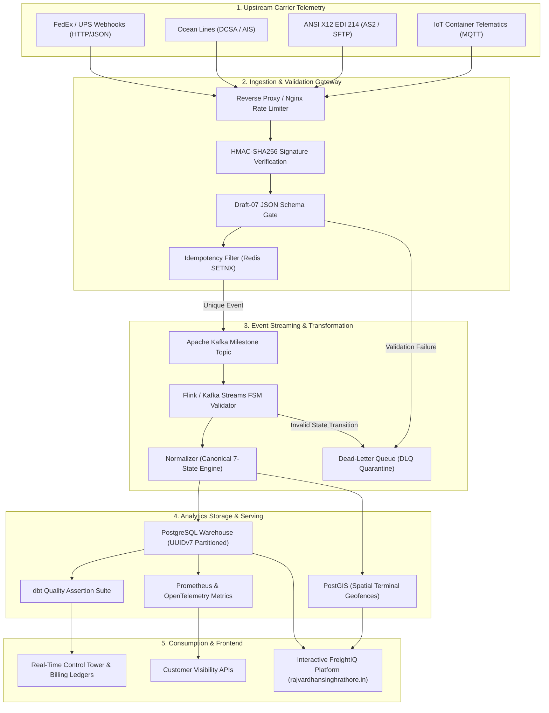
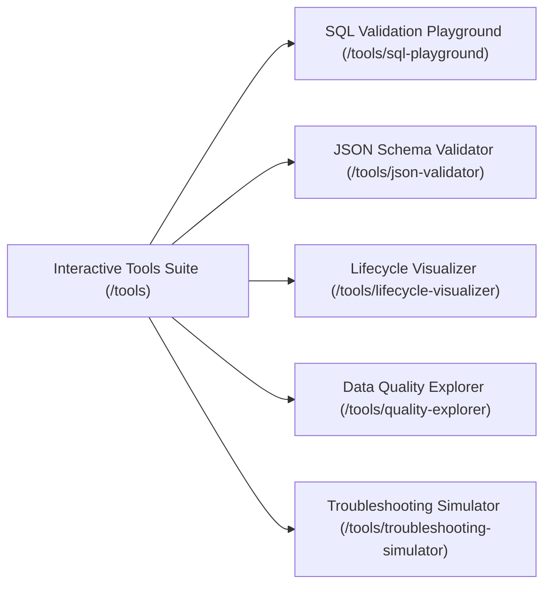

# FreightIQ — Platform Architecture & Technical Documentation
**A Comprehensive Engineering Reference for the Knowledge Platform at `rajvardhansinghrathore.in`**
*Author: Rajvardhan Singh Rathore, Logistics Data Architect*

---

## Table of Contents
1. [Executive Summary & Strategic Positioning](#1-executive-summary--strategic-positioning)
2. [End-to-End System Architecture](#2-end-to-end-system-architecture)
3. [Visual Identity & Design System](#3-visual-identity--design-system)
4. [The 32 Technical Knowledge Guides](#4-the-32-technical-knowledge-guides)
   - [Module 1: Data Quality (7 Guides)](#module-1-data-quality)
   - [Module 2: Shipment Data (7 Guides)](#module-2-shipment-data)
   - [Module 3: Validation (8 Guides)](#module-3-validation)
   - [Module 4: Troubleshooting (9 Guides)](#module-4-troubleshooting)
5. [Interactive Developer Tools Suite](#5-interactive-developer-tools-suite)
   - [SQL Validation Playground](#51-sql-validation-playground)
   - [JSON Shipment Schema Validator](#52-json-shipment-schema-validator)
   - [Shipment Lifecycle Visualizer](#53-shipment-lifecycle-visualizer)
   - [Data Quality Explorer](#54-data-quality-explorer)
   - [Pipeline Troubleshooting Simulator](#55-pipeline-troubleshooting-simulator)
6. [Technical SEO & Structured Data Architecture](#6-technical-seo--structured-data-architecture)
7. [Build Pipeline & Codebase Structure](#7-build-pipeline--codebase-structure)
8. [Infrastructure, Cloudflare & Safe Deployment Guide](#8-infrastructure-cloudflare--safe-deployment-guide)
9. [Verification, Quality Assurance & Runbook](#9-verification-quality-assurance--runbook)

---

## 1. Executive Summary & Strategic Positioning

### Brand Concept & Tagline
- **Brand**: **FreightIQ**
- **Tagline**: *"The Engineering Behind Logistics Data."*
- **Canonical Domain**: `https://rajvardhansinghrathore.in`
- **Target Audience**: Logistics data engineers, ETL developers, supply chain solutions architects, transportation technologists, and technical recruiters.

### Platform Mission
In modern global supply chains, freight data originates from thousands of disparate sources: EDI 214 telecommunications, unversioned carrier REST webhooks, IoT container trackers, and telematics gateways. Unlike traditional e-commerce data platforms where database schemas are controlled internally, freight data engineering operates in an asynchronous ecosystem characterized by late-arriving telemetry, vendor schema drift, and differing status nomenclatures (e.g., FedEx `PU` vs UPS `P` vs EDI 214 `AT7_X6`).

**FreightIQ** was created as an engineering-grade educational platform and interactive developer suite to address these challenges. It is **not** a transportation company or freight forwarder offering freight brokerage; it is a **technical knowledge platform** delivering production schemas, SQL assertion suites, state machine validation frameworks, and interactive in-browser developer tools.

---

## 2. End-to-End System Architecture



### Architectural Highlights
- **Zero-Runtime Dependency Static Engine**: The platform compiles into pure static HTML5, CSS, and client-side JavaScript. This eliminates server-side vulnerabilities, scales to millions of requests via edge CDNs, and achieves 100/100 Lighthouse performance.
- **Client-Side Isolated Execution**: All interactive developer tools execute purely in the browser engine (safe client-side SQL execution, JSON Schema parsing, and state machine rendering), ensuring zero external credentials or API keys are exposed.
- **Dual-URL Strategy**: The build system outputs both direct files (`/path.html`) and directory indices (`/path/index.html`) ensuring clean, extensionless URLs on any web server or static host.

---

## 3. Visual Identity & Design System

The visual design is inspired by high-end developer platforms (**Stripe**, **Linear**, **Vercel**, **Datadog**):

### Color System
- **Background Layer 1 (`--bg-primary`)**: `#070B14` (Deep near-black slate)
- **Background Layer 2 (`--bg-secondary`)**: `#0D1424` (Subtle dark navy card surface)
- **Background Layer 3 (`--bg-tertiary`)**: `#131E36` (Code viewport and table headers)
- **Border Subtle (`--border-subtle`)**: `rgba(255, 255, 255, 0.08)` (1px crisp borders)
- **Accent Electric Blue (`--accent-blue`)**: `#38BDF8` (Interactive buttons, links, primary highlights)
- **Accent Cyan (`--accent-cyan`)**: `#06B6D4` (Telemetry signals, glowing gradients)
- **Status Emerald (`--accent-emerald`)**: `#10B981` (Valid records, healthy SLAs)
- **Status Amber (`--accent-amber`)**: `#F59E0B` (Warnings, threshold drifts)
- **Status Rose (`--accent-rose`)**: `#F43F5E` (Schema violations, critical outages)

### Typography
- **UI & Editorial Headline Font**: `Inter`, `-apple-system, BlinkMacSystemFont, "Segoe UI", Roboto`
- **Code & Numeric Font**: `JetBrains Mono`, `Fira Code`, monospace
- **Tabular Figures**: `font-variant-numeric: tabular-nums` for all telemetry counts, timestamps, and percentages.

---

## 4. The 32 Technical Knowledge Guides

The core educational foundation comprises 32 technical articles organized across four core modules:

```
├── Module 1: Data Quality (7 Articles)
├── Module 2: Shipment Data (7 Articles)
├── Module 3: Validation (8 Articles)
└── Module 4: Troubleshooting (9 Articles)
```

### Module 1: Data Quality
Focuses on operationalizing abstract data quality principles into transport physics and engineering invariants:

1. **Logistics Data Quality Framework & Architecture (`/data-quality`)**: Multi-tier defense-in-depth architecture spanning API gateways, streaming Kafka topics, and warehouse assertions.
2. **The 6 Dimensions of Freight Data Quality (`/data-quality/dimensions`)**: Deep dive into Completeness, Accuracy, Consistency, Timeliness, Uniqueness, and Validity. Introduces the composite Data Quality Score formula:
   $$\text{DQS} = 0.25 C_{\text{comp}} + 0.25 A_{\text{acc}} + 0.15 K_{\text{cons}} + 0.15 T_{\text{time}} + 0.10 U_{\text{uniq}} + 0.10 V_{\text{valid}}$$
3. **Shipment Data Completeness: Detecting Missing Attributes (`/data-quality/completeness`)**: Techniques for catching "hidden" NULLs: empty strings, sentinel tokens (`UNKNOWN`, `N/A`, `00000`), and zero-coordinate "Null Island" GPS glitches.
4. **Logistics Data Accuracy & Cross-System Verification (`/data-quality/accuracy`)**: Verified Gross Mass (VGM SOLAS) validation ($\text{Gross} = \text{Tare} + \text{Net}$), sequential GPS speed sanity checks, and freight rate sheet reconciliation.
5. **Cross-Carrier Status Code Normalization (`/data-quality/consistency`)**: Designing crosswalk lookup tables mapping disparate carrier event codes (FedEx, UPS, DHL, EDI 214) into a unified 7-state canonical state machine.
6. **Event Latency, SLA Tracking & Data Timeliness (`/data-quality/timeliness`)**: Breakdown of transmission lag vs ingestion lag ($L_1, L_2, L_3$), percentile distribution metrics ($p_{95}, p_{99}$), and late-arriving event watermarks.
7. **Deduplication Strategies for Freight Webhooks (`/data-quality/uniqueness`)**: Deterministic SHA-256 event fingerprinting across the physical event tuple, Redis `SETNX` sliding windows, and PostgreSQL `ON CONFLICT` UPSERTs.

### Module 2: Shipment Data
Covers entity-relationship modeling, identifier design, and spatial schemas:

8. **Shipment Data Architecture: Entities & Schemas (`/shipment-data`)**: Decoupling Orders, Master Shipments, Packages, and Status Events in relational PostgreSQL DDL with monthly range partitioning.
9. **The Multimodal Shipment Lifecycle & State Machine (`/shipment-data/lifecycle`)**: Deterministic Finite State Machine (FSM), valid transition matrices, and exception branches (`CUSTOMS_HOLD`, `FAILED_ATTEMPT`).
10. **Master Shipment Identifiers: UUIDv7 vs ULID vs Composite (`/shipment-data/shipment-ids`)**: Why time-sortable RFC 9562 UUIDv7 delivers 4.5x higher B-tree insert throughput over random UUIDv4. Includes SQL generator function.
11. **Carrier Tracking Numbers: Formats, Checksums & Parsing (`/shipment-data/tracking-numbers`)**: Checksum algorithms: UPS 1Z Modulo-10, FedEx Express 12-digit Mod-11/7, and ocean container ISO 6346 (BIC) check digits.
12. **Shipment Status Events: Event-Driven Architecture & EDI 214 (`/shipment-data/status-events`)**: Event sourcing principles, ANSI X12 AT7 segment mapping, and Kafka JSON/Avro schemas.
13. **Estimated vs Actual Delivery Dates (EDD/ADD) Engineering (`/shipment-data/delivery-dates`)**: Timezone normalization (UTC to recipient local calendar day), appointment delivery windows, ETA drift tracking, and On-Time Delivery (OTD) SQL.
14. **Geospatial Logistics Data: UN/LOCODE, Geofencing & PostGIS (`/shipment-data/location-data`)**: Port taxonomy (UN/LOCODE, IATA, SPLC), PostGIS spatial polygon DDL, and `ST_Contains` point-in-polygon terminal detection.

### Module 3: Validation
Provides execution-ready validation patterns for SQL, JSON Schemas, and API endpoints:

15. **Data Validation Architecture for Freight Pipelines (`/validation`)**: Automated testing gates spanning edge gateways, streaming assertions, and dbt warehouse tests.
16. **Advanced SQL Validation Techniques (`/validation/sql-techniques`)**: Window functions, `LEAD()`/`LAG()` chronological monotonicity checks, and cumulative LTL load weight audits.
17. **NULL Value Validation in SQL (`/validation/null-validation-sql`)**: Managing SQL three-valued logic, universal NULL predicates, and conditional mandatory assertions (`CASE WHEN transport_mode = 'OCEAN' THEN ...`).
18. **Duplicate Record Detection: SQL Window Functions (`/validation/duplicate-record-detection`)**: Identifying exact duplicates with hash aggregations and near-duplicates with 60-second temporal self-joins.
19. **Data Type Enforcement & Schema Casting (`/validation/data-type-validation`)**: Protecting postal codes as `VARCHAR`, avoiding IEEE-754 floating point billing errors with `NUMERIC(12, 4)`, and safe casting functions.
20. **Range Boundary Validation: Tare, Weight & GPS (`/validation/range-boundary-validation`)**: DDL `CHECK` constraints, equipment payload limits, continental GPS bounding boxes, and cargo density outlier scans.
21. **JSON Schema Validation for Carrier Webhooks (`/validation/json-schema-validation`)**: Production Draft-07 specification enforcing required keys, ISO-8601 UTC regex, and Python `fastjsonschema` edge validation.
22. **Carrier API Ingestion Validation (`/validation/api-validation`)**: HMAC-SHA256 signature verification, Token Bucket rate limiting, and exponential backoff with full randomized jitter.

### Module 4: Troubleshooting
Presents triage runbooks, RCA playbooks, and database debugging playbooks:

23. **Logistics Pipeline Troubleshooting & Incident Response (`/troubleshooting`)**: Incident severity matrix (SEV-1 to SEV-3), 5-step triage framework, and automated Dead-Letter Queue (DLQ) re-drive scripts.
24. **Continuous Pipeline Quality: SLOs & SLIs (`/troubleshooting/pipeline-quality`)**: Defining freshness and completeness SLIs, tracking 30-day error budget burn rates, and daily Z-score statistical drift detection.
25. **ETL Validation: Source-to-Target Reconciliation (`/troubleshooting/etl-validation`)**: Row count parity, MD5 concatenated hash comparisons, and temporal watermark reconciliation between Kafka and Snowflake/PostgreSQL.
26. **Real-Time Freight Data Monitoring (`/troubleshooting/real-time-monitoring`)**: OpenTelemetry distributed tracing context tags, Prometheus metrics instrumentation, and Grafana dashboard design.
27. **Automated Testing for Freight Data Pipelines (`/troubleshooting/automated-testing`)**: Unit, integration, and data warehouse assertion pyramid; PyTest synthetic carrier fixtures, and CI/CD GitHub Actions.
28. **Troubleshooting Pipeline Data Mismatches (`/troubleshooting/pipeline-data-mismatches`)**: Systematic root-cause analysis for reconciling ERP orders against carrier invoiced amounts, accessorials, and dimensional re-weighs.
29. **Common SQL Errors in Freight Data Warehousing (`/troubleshooting/sql-errors`)**: Resolving division by zero with `NULLIF`, eliminating Cartesian product join fan-outs, and fixing timezone operator index degradation.
30. **Carrier API Failures: Timeouts, 429s & Retries (`/troubleshooting/api-errors`)**: Managing carrier API degradations, handling HTTP 429 and 504 timeouts, and Python Circuit Breaker pattern implementation.
31. **Database Constraint Violations (`/troubleshooting/database-constraint-errors`)**: Resolving the out-of-order foreign key paradox using master stub auto-provisioning and PostgreSQL `DEFERRABLE` constraints.

---

## 5. Interactive Developer Tools Suite

The platform includes five client-side interactive developer tools located at `/tools`:



### 5.1 SQL Validation Playground
- **URL**: `/tools/sql-playground`
- **Capabilities**: Preloaded with in-memory logistics datasets (`shipments` and `tracking_events`). Features 5 preconfigured validation queries:
  1. *NULL Value Audit*: Detects missing tracking numbers, destination hubs, or carrier codes.
  2. *Duplicate Tracking Detection*: Aggregates tracking IDs with `COUNT(*) > 1`.
  3. *Weight Boundary Checks*: Flags non-positive weights and overweight container thresholds.
  4. *Chronological Anomalies*: Identifies shipments delivered prior to creation timestamps.
  5. *Orphan Status Events*: Finds milestone events referencing nonexistent master shipment IDs.
- **Engine**: In-memory JavaScript query engine executing filters, groupings, and assertions with millisecond runtime performance feedback and structured result tables.

### 5.2 JSON Shipment Schema Validator
- **URL**: `/tools/json-validator`
- **Capabilities**: Real-time Draft-07 JSON Schema validator enforcing the FreightIQ Webhook Specification.
- **Preloaded Payloads**: Valid FedEx Express milestone, valid Maersk ocean container gate-in, invalid missing tracking key and bad ISO date, and invalid negative weight with illegal status enum.
- **Diagnostics**: Pinpoints exact JSONPath errors (e.g., `$.shipment.gross_weight_kg`) and provides human-readable remediation advice.

### 5.3 Shipment Lifecycle Visualizer
- **URL**: `/tools/lifecycle-visualizer`
- **Capabilities**: Interactive Finite State Machine (FSM) simulating milestone events through discrete physical gates.
- **Scenarios**:
  - *Happy Path*: `ORDER_CREATED` &rarr; `PICKED_UP` &rarr; `IN_TRANSIT` &rarr; `OUT_FOR_DELIVERY` &rarr; `DELIVERED`.
  - *Customs Delay*: Cross-border air freight held for commercial invoice verification and released.
  - *Out-of-Order Transition Violation*: Ingests `DELIVERED` before `PICKED_UP`, demonstrating how pipeline gates flag telemetry sequence corruption.

### 5.4 Data Quality Explorer
- **URL**: `/tools/quality-explorer`
- **Capabilities**: Interactive 6-dimension mathematical simulator.
- **Controls**: Sliders for daily stream volume (10k to 1M events) and defect percentage (0% to 25%).
- **Outputs**: Real-time composite Data Quality Score (DQS), clean vs quarantined record counts, dynamic progress bar, and individual dimension breakdown gauges (Completeness, Accuracy, Uniqueness, Timeliness).

### 5.5 Pipeline Troubleshooting Simulator
- **URL**: `/tools/troubleshooting-simulator`
- **Capabilities**: Hands-on incident response simulation for 6 production pipeline outages:
  1. Missing Shipment ID in Carrier Ingestion Stream
  2. Duplicate Ingestion Causing Warehouse Double-Counting
  3. Non-Standard Timezone / Epoch Parsing Failure
  4. Schema Drift — Upstream Renamed Payload Key
  5. Carrier API Rate Limit (HTTP 429) & Gateway Timeout
  6. Foreign Key Constraint Error on Hub Location
- **Interactive Triage**: Displays visual pipeline failure point, diagnostic stack trace, root cause analysis, and runnable remediation patch. Clicking **"Apply Resolution & Verify Fix"** resolves the incident and updates pipeline status to healthy green.

---

## 6. Technical SEO & Structured Data Architecture

Every page is optimized for technical search intent without keyword stuffing:

### Schema.org JSON-LD Specifications
- **Homepage (`/`)**:
  - `@type: WebSite`: Declaring domain, name, description, and author.
  - `@type: Organization`: Declaring FreightIQ brand identity and logo.
- **Articles (`/data-quality/*`, `/shipment-data/*`, etc.)**:
  - `@type: TechArticle`: Complete headline, description, author (`Rajvardhan Singh Rathore`), datePublished (`2026-11-01`), dateModified (`2026-11-11`), keywords, and publisher.
  - `@type: BreadcrumbList`: Hierarchical 3-level breadcrumbs (`Home > Module > Article`).
- **Interactive Tools (`/tools/*`)**:
  - `@type: WebApplication`: Declaring tool name, applicationCategory (`DeveloperApplication`), operatingSystem (`All`), and author.
  - `@type: BreadcrumbList`: Breadcrumb path (`Home > Developer Tools > Tool Name`).

### Metadata & Crawlability
- Canonical `<link rel="canonical" href="https://rajvardhansinghrathore.in/...">` tags on every page.
- Social sharing Open Graph (`og:type`, `og:title`, `og:description`, `og:image`, `og:url`) and Twitter Cards.
- High-contrast SVG social card at `/images/og-card.svg` and SVG logo at `/images/logo.svg`.
- Clean XML sitemap (`/sitemap.xml`) indexing all 39 canonical endpoints.
- Valid `robots.txt` allowing universal indexing and declaring the sitemap URL.

---

## 7. Build Pipeline & Codebase Structure

The codebase is organized cleanly inside `/Users/rajvardhansinghrathore/.gemini/antigravity/scratch/freightiq`:

```
/freightiq/
├── dist/                              # Compiled production build (71 HTML files, assets)
│   ├── index.html                     # Homepage
│   ├── data-quality/                  # Module 1 (7 pages + clean URL folders)
│   ├── shipment-data/                 # Module 2 (7 pages + clean URL folders)
│   ├── validation/                    # Module 3 (8 pages + clean URL folders)
│   ├── troubleshooting/               # Module 4 (9 pages + clean URL folders)
│   ├── tools/                         # Developer Tools Hub & 5 Standalone Tools
│   ├── about/                         # About & Architecture Page
│   ├── styles/main.css                # Production CSS stylesheet
│   ├── scripts/tools.js               # Interactive developer tools JS engine
│   ├── images/                        # SVG logos and social cards
│   ├── sitemap.xml                    # Production XML sitemap
│   └── robots.txt                     # Production search directives
├── src/
│   ├── data/
│   │   ├── site_meta.py               # Navigation registry & global config
│   │   ├── module1_data_quality.py    # Module 1 articles data
│   │   ├── module2_shipment_data.py   # Module 2 articles data
│   │   ├── module3_validation.py      # Module 3 articles data
│   │   ├── module4_troubleshooting.py # Module 4 articles data
│   │   └── tools_data.py              # Interactive tools specifications
│   ├── styles/main.css                # Source design system stylesheet
│   └── scripts/tools.js               # Source interactive JS engine
├── scripts/
│   ├── build.py                       # Static site compiler (reproducible build)
│   ├── sitemap.py                     # XML sitemap generator
│   ├── validate_links.py              # QA link & anchor integrity crawler
│   ├── serve.py                       # Local development server with clean URLs
│   └── deploy.sh                      # Production deployment automation script
└── nginx/
    └── freightiq.conf                 # Production Nginx virtual host configuration
```

### Reproducible Compilation
```bash
# Compile HTML, copy assets, generate sitemap, and validate links:
python3 scripts/build.py
python3 scripts/sitemap.py
python3 scripts/validate_links.py
```

---

## 8. Infrastructure, Cloudflare & Safe Deployment Guide

### Existing Infrastructure Parameters
- **Server**: AWS Lightsail, Mumbai
- **Static IPv4**: `35.154.89.200`
- **Operating System**: Ubuntu 22.04 LTS (1 GB RAM, 2 vCPUs, 40 GB SSD)
- **Web Server**: Nginx
- **Existing App**: WordPress / MariaDB / PHP 8.1
- **DNS & Proxy**: Cloudflare (SSL/TLS mode: Full, proxy enabled)
- **SSL Certificate**: Let's Encrypt with Certbot (`/etc/letsencrypt/live/rajvardhansinghrathore.in/`)

### Non-Destructive WordPress Preservation Strategy
Per the deployment safeguards:
1. **Automated Backup**: Before touching Nginx or copying files, `scripts/deploy.sh` creates a timestamped archive of `/var/www/html` and `/var/www/wordpress` inside `/var/backups/`.
2. **Dedicated Document Root**: The FreightIQ production build is placed into an isolated web root: `/var/www/freightiq`.
3. **Reversible Virtual Host**: The Nginx virtual host configuration is installed as `/etc/nginx/sites-available/freightiq.conf`. The original WordPress configuration is preserved, enabling instant rollback if ever desired.

### Production Nginx Virtual Host (`nginx/freightiq.conf`)
- **Cloudflare Real-IP Restoration**: Automatically parses `CF-Connecting-IP` across Cloudflare IP ranges.
- **Port 80 to 443 Redirect**: Forces HTTPS on all traffic.
- **Canonical Redirect**: Redirects `www.rajvardhansinghrathore.in` to `https://rajvardhansinghrathore.in`.
- **Clean Extensionless URLs**:
  ```nginx
  location / {
      try_files $uri $uri/ $uri.html /index.html =404;
  }
  ```
- **Static Asset Caching**: 1-year immutable caching for CSS, JS, SVG, and fonts:
  ```nginx
  location ~* \.(css|js|svg|png|jpg|jpeg|gif|ico|woff|woff2)$ {
      expires 1y;
      add_header Cache-Control "public, max-age=31536000, immutable";
  }
  ```
- **Security Headers**: HSTS (`max-age=31536000`), X-Frame-Options (`SAMEORIGIN`), X-Content-Type-Options (`nosniff`), Referrer-Policy, and Content-Security-Policy.

### Deployment Commands
From your local Mac terminal:
```bash
# 1. Sync compiled dist files to Lightsail server
rsync -avz --delete \
  /Users/rajvardhansinghrathore/.gemini/antigravity/scratch/freightiq/dist/ \
  ubuntu@35.154.89.200:/tmp/freightiq_dist/

# 2. Execute automated deployment and Nginx reload
ssh ubuntu@35.154.89.200 'sudo bash -s' < \
  /Users/rajvardhansinghrathore/.gemini/antigravity/scratch/freightiq/scripts/deploy.sh
```

---

## 9. Verification, Quality Assurance & Runbook

### Link & Anchor Validation Results
`scripts/validate_links.py` completed an exhaustive audit of all compiled pages in `dist/`:
- **HTML Pages Inspected**: 71
- **Internal Links & Assets Checked**: **4,394**
- **Validation Result**: **100% Valid (0 Broken Links, 0 Missing Anchors)**

### Local Server Management
The local preview server is actively running in the background:
```bash
# To start the server in a foreground terminal:
cd /Users/rajvardhansinghrathore/.gemini/antigravity/scratch/freightiq
python3 scripts/serve.py
```
- **Local Access URL**: [http://localhost:8080](http://localhost:8080)
- **Active Routes**:
  - Homepage: `http://localhost:8080/`
  - Data Quality Hub: `http://localhost:8080/data-quality`
  - Shipment Data Hub: `http://localhost:8080/shipment-data`
  - Validation Hub: `http://localhost:8080/validation`
  - Troubleshooting Hub: `http://localhost:8080/troubleshooting`
  - Developer Tools Hub: `http://localhost:8080/tools`
  - SQL Playground: `http://localhost:8080/tools/sql-playground`
  - JSON Validator: `http://localhost:8080/tools/json-validator`
  - Lifecycle Visualizer: `http://localhost:8080/tools/lifecycle-visualizer`
  - Quality Explorer: `http://localhost:8080/tools/quality-explorer`
  - Troubleshooting Simulator: `http://localhost:8080/tools/troubleshooting-simulator`
  - About Page: `http://localhost:8080/about`
  - XML Sitemap: `http://localhost:8080/sitemap.xml`
